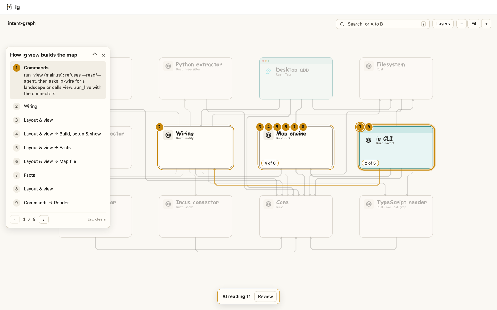
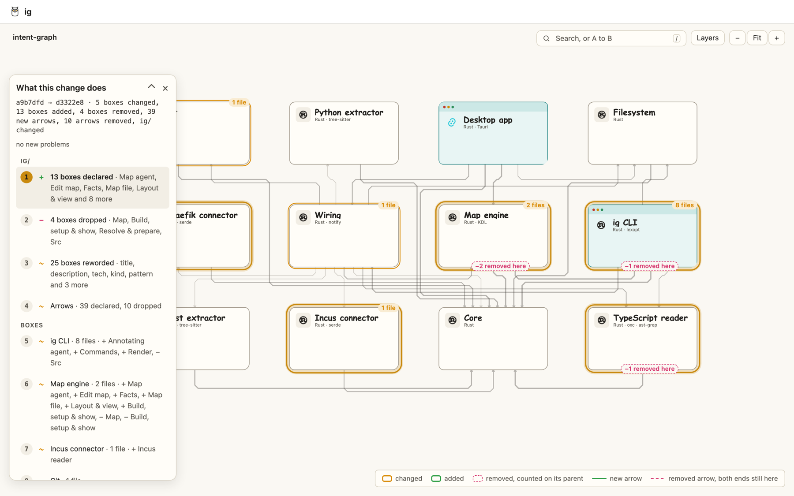

<p align="center"><picture><source media="(prefers-color-scheme: dark)" srcset="assets/brand/lockup-dark.svg"></picture></p>

<h3 align="center">The architecture you meant, drawn from the code you have.</h3>

<p align="center">
  <a href="#install">Install</a> ·
  <a href="#quick-start">Quick start</a> ·
  <a href="docs/reference.md">Reference</a> ·
  <a href="docs/specs/design.md">Design</a>
</p>

<p align="center"><picture><source media="(prefers-color-scheme: dark)" srcset="assets/screenshots/explore-dark.png"></picture></p>

**ig** (say *"eye-gee"*, short for *intent graph*) reads a TypeScript/JavaScript, Python or Rust repo and draws it as a **system map**: a canvas you can walk from the whole system down to a single function. You commit the architecture you intend in `ig/`, and ig checks the code against it on every run. Ask it a question and the answer is drawn on the map; give it a branch and it shows what the change does to the architecture.

One binary, written in Rust. The map is a single offline HTML page.

## What you get

- **A map you can walk.** Packages, folders, modules and functions as nested boxes, with real imports and calls as arrows. Zoom into a box to open it up; a card shows its description, tech and where each value came from.
- **Answers drawn on the map.** `ig explore "how does checkout work"` prints the answer and lights the path through the system, step by step.
- **Architecture review for every diff.** `ig diff main` shows what a branch does to the system: boxes changed, added and removed, new arrows, broken rules. The page walks you through the change.
- **Intent that stays true.** `ig/` is plain KDL you commit and review. `ig plan` lists what is still to build and where the code has drifted; `ig check` fails CI when they disagree.
- **Your agent can use it too.** `ig mcp` lets Claude Code (or any MCP client) read the map and draw its answers on it.
- **Your choice of AI, or none.** The map is built from the code alone. An agent (`claude`, `gemini` or `codex`) only runs to name and describe boxes, and only when you ask.

## Review a change

<p align="center"><picture><source media="(prefers-color-scheme: dark)" srcset="assets/screenshots/diff-dark.png"></picture></p>

```console
$ ig diff 03d4b9d c251685
03d4b9d..c251685: 2 boxes changed, 1 new arrow Web → Core
  changed  Src (core/root) (1 file)
  changed  Src (web/root) (1 file)
  arrow +  Web → Core (bundle)
```

Both sides are built from a temporary checkout, so ig never touches your branches or working tree. `--json` gives the same result to scripts and CI.

## Install

**Homebrew** (macOS and Linux):

```sh
brew install mrzdevcore/tap/ig
```

**From source** (needs Rust, node and pnpm):

```sh
git clone https://github.com/mrzdevcore/intent-graph && cd intent-graph
make install
```

`ig` needs `git` on `PATH` and nothing else. The AI reading needs the `claude`, `gemini` or `codex` CLI, and only when you ask for it.

## Quick start

```sh
ig init                          # ig.yaml, the agent skills, an AGENTS.md snippet
ig analyse                       # read the code and write ig/ for you to review
ig view                          # draw the map and open it
ig explore "how does X work"     # the answer on stdout, drawn on the map
ig diff main                     # what this branch does to the architecture
```

Review `ig/` with `git diff ig/` and commit it. From then on it is yours: edit it by hand, or let `ig accept` and your agent propose changes.

## Three ways to use it

| You have… | You run… | You get… |
|---|---|---|
| **A repo you need to understand** | `ig analyse`, `ig view`, `ig explore` | The system on one page, and answers drawn on it |
| **An architecture in mind** | edit `ig/`, then `ig plan` | What is still to build, what has drifted, what is out of place |
| **A change to review** | `ig diff <base>` | The change on the map, and the rules it breaks or fixes |

## Commands

| Command | What it does |
|---|---|
| `ig init` | Sets the repo up: `ig.yaml`, agent skills, an `AGENTS.md` snippet |
| `ig analyse` | Reads the code and writes `ig/` (or proposes updates to it) |
| `ig view` | Draws the map and opens it; read-only |
| `ig explore "<question>"` | Asks Claude; the answer is drawn on the map |
| `ig diff [<base> [<head>]]` | Shows what a change does to the architecture |
| `ig plan` | What to build, move and accept to bring code and map together |
| `ig check` | Exits 1 when code and map have drifted (for CI) |
| `ig accept <id>…` | Takes drift into `ig/` |
| `ig fmt` | Rewrites `ig/` in canonical form |
| `ig mcp` | Serves the map to an agent over MCP |

Every flag, the `ig.yaml` keys, layers, connectors and the desktop app are in the **[reference](docs/reference.md)**.

## How it works

ig parses the repo (oxc for TypeScript/JavaScript, tree-sitter for Python and Rust) into a graph of modules, classes, functions, tests and your own ast-grep patterns. The map is built in three passes:

1. **Facts:** packages, folders, imports, calls and file counts. No AI; every box and arrow exists after this.
2. **Reading** (optional): an agent with read-only tools names each box, describes it and spots its pattern (onion, hexagonal, layered). Every value records whether it came from the agent or from ig, and how sure it is.
3. **Layers:** rule breaks, risks, and anything your own tools write to `.ig/layers/*.json`.

The design is in [docs/specs/design.md](docs/specs/design.md); building and testing ig itself is under [Development](docs/reference.md#development).
